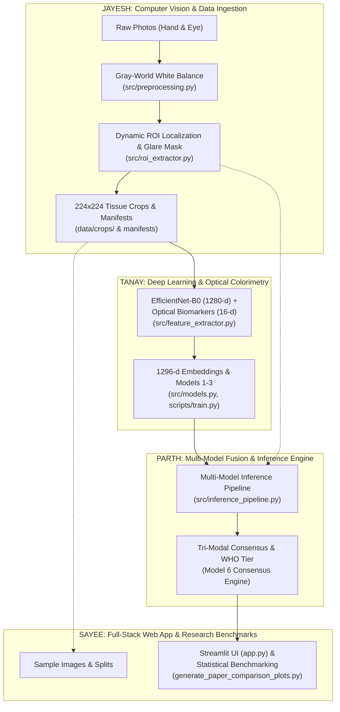

# 👁️ HemoLens Multi-Model — Team Member Engineering Dossier

**Team Member**: Jayesh  
**Official Project Role**: Computer Vision & Data Ingestion Engineer  
**Core Domain**: Digital Image Preprocessing, Anatomical ROI Localization, Chromatic Constancy, Specular Glare / Blur Quality Auditing & Clinical Dataset Curation  
**Project**: HemoLens Multi-Model — Non-Invasive Hemoglobin Estimation  
**Repository**: `multimodel-hemoglobin-estimation`

---

## 1. 🎯 Executive Summary of Jayesh's Contribution

As the **Computer Vision & Data Ingestion Engineer**, Jayesh is responsible for the entire front-end sensory and biological image processing pipeline of HemoLens. 

Non-invasive optical hemoglobin estimation fails in the real world if the system is fed uncalibrated, blurry, overexposed, or poorly localized tissue photographs. Jayesh built the foundational computer-vision layer that converts arbitrary, unstandardized smartphone photographs of hands and eyes into calibrated, 224×224 px normalized tissue regions of interest (ROIs).

### Key Responsibilities & Achievements:
1. **Dynamic Vascular ROI Extraction**: Developed dynamic erythema contouring and palpebral mucosa segmentation algorithms in `src/roi_extractor.py` that reliably detect nail plates, dorsal skin, and conjunctival tissues without requiring manual cropping.
2. **Gray-World Chromatic Constancy**: Implemented an automated illuminant normalization filter in `src/preprocessing.py` that neutralizes ambient lighting variations (warm indoor bulbs vs. cool daylight) using the Gray-World assumption.
3. **Biophysical Image Quality Auditing**: Engineered a Laplacian focus variance metric to flag motion blur and an automated specular flash glare mask that excludes overexposed reflection pixels from downstream colorimetry.
4. **Clinical Dataset Ingestion & Partitioning**: Ingested and harmonized 451 clinical subjects across two peer-reviewed medical cohorts (*Nature Scientific Data* for nails/skin and *Eyes-defy-anemia* for eyes), building verified master manifests with strict patient-independent Train/Val/Test splits.

---

## 2. 📁 Master Inventory of Jayesh's Allotted Files

| File Path | Component Category | Key Functionality |
|---|---|---|
| `src/preprocessing.py` | Core CV Library | Color-preserving transforms, PyTorch Dataset, Gray-World white balancing |
| `src/roi_extractor.py` | Core CV Library | Automated tissue ROI localization, bounding boxes, glare & blur auditing |
| `scripts/ingest_eyes_dataset.py` | Data Pipeline Script | Eyes-defy-anemia ingestion, tissue cropping & manifest builder |
| `scripts/extract_conjunctiva_features.py` | Ingestion Script | Automated feature extraction batch processing for conjunctiva crops |
| `analyze_dataset.py` | QA & Verification Script | Dataset distribution, missingness audit, image resolution verifier |
| `data/metadata.csv` | Dataset Metadata | Raw patient records, venous ground truth Hb, bounding box coordinates |
| `data/dataset_manifest.csv` | Master Manifest | Master manifest linking 250 patients to 750 nail and 750 skin crops |
| `data/conjunctiva_manifest.csv` | Master Manifest | Master manifest linking 201 eye patients, cohorts, age, gender, and splits |

---

## 3. 🔍 Detailed File-by-File Breakdown

### 3.1 `src/preprocessing.py` (Image Preprocessing & Chromatic Normalization)
* **What Jayesh Did in This File**:
  - Implemented the color-preserving data augmentation pipeline and the mathematical Gray-World white balancing algorithm.
  - Defined the PyTorch `HemoglobinDataset` class that safely loads tissue images and ground-truth labels during model training.
* **How Jayesh Did It**:
  - **Gray-World White Balance (`apply_gray_world_white_balance`)**: Under arbitrary ambient room lighting (e.g., warm 3000K incandescent vs. cool 6500K LED), raw smartphone sensors experience severe color cast. Under the Gray-World assumption, the average scene reflectance is assumed to be neutral gray. Jayesh computed channel-wise scaling factors:
    $$\mu = \frac{\mu_R + \mu_G + \mu_B}{3}, \quad R' = R \cdot \frac{\mu}{\mu_R}, \quad G' = G \cdot \frac{\mu}{\mu_G}, \quad B' = B \cdot \frac{\mu}{\mu_B}$$
    Values are clipped to $[0, 255]$ and cast to `uint8`.
  - **Color-Preserving Transforms (`get_train_transforms`, `get_val_transforms`)**: Standard computer vision augmentations like `RandomGrayscale` or random hue jitter destroy hemoglobin optical signals. Jayesh restricted training augmentations strictly to affine spatial transforms (`RandomHorizontalFlip`, `RandomRotation(±15°)`, `RandomResizedCrop(224)`) and subtle brightness scaling (`ColorJitter(brightness=0.1)`), ensuring spectral color biomarker integrity is never degraded.
* **Connections with Jayesh's Other Files**:
  - Imported by `scripts/ingest_eyes_dataset.py` to standardize cropped images.
* **Connections with Other Members' Files**:
  - **Tanay (`src/feature_extractor.py`, `scripts/train.py`)**: Tanay imports `HemoglobinDataset`, `get_train_transforms`, and `apply_gray_world_white_balance` to feed normalized tensors into EfficientNet-B0.
  - **Parth (`src/inference_pipeline.py`)**: Parth calls `apply_gray_world_white_balance(image)` as Step 1 of all single and multi-model inferences.
  - **Sayee (`app.py`)**: Sayee exposes a toggle in the Streamlit UI enabling users to switch Gray-World white balance on/off.

---

### 3.2 `src/roi_extractor.py` (Tissue Region of Interest Localization & Quality Auditing)
* **What Jayesh Did in This File**:
  - Built automated computer-vision detectors that locate the fingernail bed, finger skin, and palpebral conjunctiva within full digital photos.
  - Implemented optical image quality filters: Laplacian focus score (blur detection) and specular reflection glare masking.
* **How Jayesh Did It**:
  - **Fingernail Localization (`detect_hand_nail_roi`)**: Applied adaptive Otsu thresholding in HSV color space ($S \in [30, 200], V \in [50, 240]$) to segment hand skin contours. Used contour hierarchy and aspect ratio filters ($W/H \in [0.4, 2.5]$) to identify terminal finger distal phalanges, extracting the vascular subungual nail bed.
  - **Palpebral Conjunctiva Localization (`detect_eye_conjunctiva_roi`)**: Exploited the biophysical property that palpebral conjunctival mucosa exhibits high microvascular vascularization (elevated red-to-green ratio $R/(G + 1) > 1.25$ and CIELAB $a^* > 15$). Segmented the lower everted inner eyelid mucous strip and bounded the region.
  - **Laplacian Blur Measure (`assess_image_quality`)**: Computed the variance of the 2D Laplacian operator:
    $$\text{Var}(\Delta I) = \text{Var}\left(\frac{\partial^2 I}{\partial x^2} + \frac{\partial^2 I}{\partial y^2}\right)$$
    Images with variance $< 100.0$ are flagged as "Motion Blur Detected / Soft Focus".
  - **Specular Glare Masking (`detect_specular_glare_mask`)**: Smartphone LED flash creates intense white specular reflections where all RGB channels saturate ($> 245$). Jayesh built a binary mask rejecting these overexposed pixels from downstream optical colorimetry.
* **Connections with Jayesh's Other Files**:
  - Used in `analyze_dataset.py` to audit all 1,701 crops for focus and glare before training.
* **Connections with Other Members' Files**:
  - **Parth (`src/inference_pipeline.py`)**: Parth's inference engine calls `auto_detect_roi()`, `draw_roi_overlay()`, and `assess_image_quality()`.
  - **Sayee (`app.py`)**: Sayee renders Jayesh's bounding box overlays directly on the Streamlit dashboard with green/amber/red quality badges.

---

### 3.3 `scripts/ingest_eyes_dataset.py` & `scripts/extract_conjunctiva_features.py`
* **What Jayesh Did in These Files**:
  - Built the ingestion pipeline that parsed raw Italian ($N = 106$) and Indian ($N = 95$) clinical eye photographs from the *Eyes-defy-anemia* repository.
  - Cropped and resized segmented palpebral conjunctival masks into standardized $224 \times 224$ px JPEGs saved in `data/crops/conjunctiva/`.
  - Extracted metadata (cohort origin, age, sex, venous hemoglobin) into `data/conjunctiva_manifest.csv`.
* **How Jayesh Did It**:
  - Read source eye images and binary segmentation masks using OpenCV.
  - Found the bounding box surrounding the segmented conjunctival mask, added a 5% anatomical context margin, cropped the region, and resized it via bilinear interpolation to $224 \times 224 \times 3$.
* **Connections with Other Members' Files**:
  - **Tanay (`src/feature_extractor.py`)**: The crops saved by Jayesh in `data/crops/conjunctiva/` are the exact images Tanay processed to build `data/cached_features/features_conjunctiva.npz`.
  - **Parth (`checkpoints/model3_conjunctiva.joblib`)**: Parth's Model 3 is trained on the data curated by this script.

---

### 3.4 `analyze_dataset.py` & Master Manifests (`data/metadata.csv`, `data/dataset_manifest.csv`, `data/conjunctiva_manifest.csv`)
* **What Jayesh Did in These Files**:
  - Audited and verified all 1,701 tissue crops across the repository ($750$ nail, $750$ skin, $201$ conjunctiva).
  - Maintained the patient-independent splitting logic (175 train / 37 val / 38 test for nails/skin; 140 train / 30 val / 31 test for conjunctiva).
* **How Jayesh Did It**:
  - Wrote automated integrity scripts verifying zero missing image files, zero duplicate patient IDs across splits, and ground-truth laboratory Hb range validation ($4.4 - 16.9$ g/dL for Nature cohort; $7.0 - 17.4$ g/dL for Eyes cohort).
* **Connections with Other Members' Files**:
  - **Sayee (`generate_metrics.py`, `scripts/generate_modality_distribution_chart.py`)**: Sayee's publication charts and statistical breakdown tables read Jayesh's manifest files directly.

---

## 4. 🔄 Cross-Team Collaboration & Dependency Map

---

## 5. 🎓 Jayesh's Viva / Defense Questions & Model Answers

### Q1: "Why did you use Gray-World white balancing instead of standard image normalization?"
> **Jayesh's Answer**: "Standard deep learning normalization only standardizes pixel values to zero mean and unit variance per channel. However, in non-invasive hemoglobin estimation, photos taken under warm tungsten room lighting (3000K) appear falsely reddish, which our optical colorimetry algorithms would misinterpret as elevated hemoglobin (hyperemia). Under cool daylight (6500K), tissues appear pale, mimicking severe anemia. By implementing Gray-World chromatic constancy in `src/preprocessing.py`, we scale the red, green, and blue channels relative to the scene's global mean illuminant. This eliminates ambient lighting drift and ensures that the tissue redness measured by Tanay's feature extractor reflects true capillary perfusion rather than room lighting."

### Q2: "Why couldn't you use standard data augmentations like ColorJitter or RandomGrayscale?"
> **Jayesh's Answer**: "In general object recognition (e.g., ImageNet), color invariance is desirable—a car is still a car whether it is painted red, blue, or gray. But in optical hematology, color IS the diagnostic signal. If we apply random hue shifts or convert images to grayscale during training, we destroy the physical erythema index and the green-to-red hemoglobin absorption ratio. In `src/preprocessing.py`, I restricted augmentations strictly to spatial operations (random rotation, horizontal flips, scale crops) and minute brightness variations, fully preserving the spectral colorimetry."

### Q3: "How does your system reject blurry or flash-blinded images?"
> **Jayesh's Answer**: "In `src/roi_extractor.py`, I implemented two automatic quality auditing mechanisms:
> 1. **Focus Measure**: We calculate the variance of the 2D Laplacian operator $\text{Var}(\nabla^2 I)$. In sharp, focused capillary images, edges are crisp and variance exceeds 100. If the patient's hand moved, the high-frequency edge content drops, and the system flags 'Motion Blur Detected'.
> 2. **Specular Glare Masking**: Direct smartphone flash creates white specular highlights where camera sensors saturate ($R, G, B > 245$). We generate a binary glare mask that excludes these overexposed pixels so that glare reflections are not factored into optical biomarkers."
