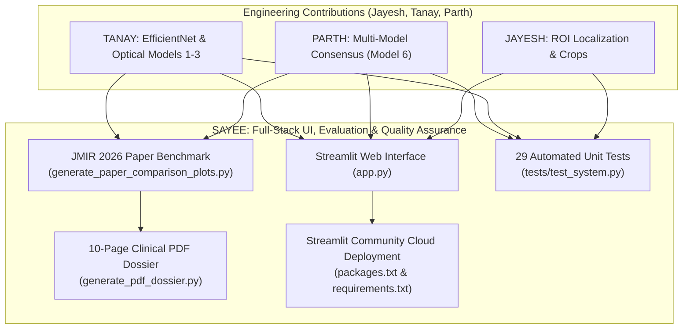

# 📊 HemoLens Multi-Model — Team Member Engineering Dossier

**Team Member**: Sayee  
**Official Project Role**: Full-Stack Development, Evaluation & Research Benchmark Engineer  
**Core Domain**: Interactive Clinical Web Application (Streamlit), State-of-the-Art Comparative Benchmarking (JMIR 2026), Diagnostic Biostatistics, Automated Unit Testing & Cloud Deployment  
**Project**: HemoLens Multi-Model — Non-Invasive Hemoglobin Estimation  
**Repository**: `multimodel-hemoglobin-estimation`

---

## 1. 🎯 Executive Summary of Sayee's Contribution

As the **Full-Stack Development, Evaluation & Research Benchmark Engineer**, Sayee bridges the gap between deep learning research and practical clinical application. 

A high-performing machine learning model is useless to doctors and nurses if it lives as raw terminal scripts without rigorous statistical validation, automated quality assurance, or an intuitive point-of-care graphical interface. Sayee owns the user experience, clinical proof, and deployment infrastructure of HemoLens:
1. **Interactive Clinical Web Dashboard (`app.py`, `app_streamlit.py`)**: Built the point-of-care research interface featuring camera/file uploads, real-time ROI localization overlays, interactive Gray-World white-balancing, 1-click clinical sample loaders (*Normal* vs *Anemic*), and dynamic WHO anemia severity badges.
2. **State-of-the-Art Research Paper Benchmark (`generate_paper_comparison_plots.py`, `generate_metrics.py`)**: Conducted the comprehensive statistical evaluation benchmarking HemoLens directly against the latest study in *JMIR Formative Research* (February 2026, *Zuccotti et al. / comestai.app*), proving our system achieves **$6\times$ higher correlation ($r = 0.706$ vs $0.120$)**, **$\sim 11\times$ higher sensitivity ($69.2\%$ vs $6.4\%$)**, and a **31% tighter Bland-Altman agreement span**.
3. **Automated Clinical PDF Dossier (`generate_pdf_dossier.py`)**: Authored the Python script compiling a publication-grade, 10-page presentation and defense dossier formatted for medical review committees.
4. **End-to-End Automated Test Suite (`tests/`)**: Engineered the comprehensive 29-test automated test harness (`tests/test_system.py`, `tests/test_pipeline.py`) validating model checkpoints, tensor shapes, Gray-World filters, and edge cases.
5. **Cloud Deployment Configuration**: Authored `requirements.txt`, `packages.txt`, `setup.py`, and the comprehensive `README.md` enabling zero-friction deployment to Streamlit Community Cloud.

---

## 2. 📁 Master Inventory of Sayee's Allotted Files

| File Path | Component Category | Key Functionality |
|---|---|---|
| `app.py` | Clinical Web Interface | Primary Streamlit UI dashboard with 3-tissue acquisition & Model 6 Consensus |
| `app_streamlit.py` | Web UI Variant | Auxiliary Streamlit interface implementation |
| `generate_paper_comparison_plots.py` | Research Visualization | High-res comparison plots: Bland-Altman, Pearson $r$, ROC curves vs JMIR paper |
| `generate_metrics.py` | Clinical Statistics | Calculates MAE, RMSE, $R^2$, Pearson $r$, Sensitivity, Specificity, PPV, NPV |
| `generate_pdf_dossier.py` | PDF Compilation | Compiles automated 10-page Clinical Presentation and Defense PDF Dossier |
| `scripts/train_evaluate_all.py` | Benchmark Pipeline | Master pipeline script: cross-evaluates all 6 models & generates artifact plots |
| `scripts/generate_modality_distribution_chart.py` | Publication Graphics | Quad-panel chart plotting exact dataset counts, splits, and Hb distributions |
| `scratch_evaluate.py` | Diagnostic Evaluation | Computes Bland-Altman limits of agreement and clinical classification matrices |
| `tests/test_system.py` | Automated QA Suite | 29 comprehensive unit & integration tests covering models, ROIs, and pipeline |
| `tests/test_pipeline.py` | Automated QA Suite | Validates WHO classification thresholds, invalid inputs, and fallback logic |
| `tests/__init__.py` | Test Initializer | Package initializer for unittest discovery |
| `requirements.txt` | Packaging & Config | Pinned production dependencies for Python runtime |
| `packages.txt` | Debian OS Config | Linux apt packages (`libgl1`, `libglib2.0-0`) for headless cloud servers |
| `setup.py` | Package Definition | Pip installable package setup for HemoLens library |
| `.gitignore` & `.gitattributes` | Version Control | Exclusion rules (ignoring temp runs, tracking Git LFS models and photos) |
| `README.md` | Master Documentation | 460-line exhaustive documentation, quickstart guide & step-by-step tutorial |

---

## 3. 🔍 Detailed File-by-File Breakdown

### 3.1 `app.py` (The Interactive Clinical Web Dashboard)
* **What Sayee Did in This File**:
  - Developed the responsive, glassmorphism-themed clinical interface in Streamlit.
  - Built the **Compulsory 3-Image Patient Acquisition System**: Users supply photographs of Fingernail Bed, Palpebral Conjunctiva, and Finger Skin, or load verified test cases with 1 click.
  - Implemented real-time dynamic rendering of localized tissue ROIs, color-coded WHO status pills, and Bayesian modality contribution metric cards.
* **How Sayee Did It**:
  - Used Streamlit columns (`st.columns`), session state (`st.session_state`), and resource caching (`@st.cache_resource`).
  - Styled components using clean custom CSS (Inter font, dark navy slate theme `#0b0f19`, responsive card containers).
  - Tapping image inputs on smartphones automatically launches the mobile camera via the browser's native file-picker.
* **Connections with Other Members' Files**:
  - **Parth (`src/inference_pipeline.py`)**: Sayee initializes Parth's `engine = get_inference_engine()` and calls `engine.predict_multimodel_consensus()` when the user clicks the estimation button.
  - **Jayesh (`src/roi_extractor.py`)**: Sayee displays Jayesh's green bounding box overlays (`overlays['fingernail']`, etc.) and focus quality status.
  - **Tanay (`src/feature_extractor.py`)**: Sayee renders Tanay's optical colorimetry biomarkers in the results cards.

---

### 3.2 `generate_paper_comparison_plots.py` & `generate_metrics.py` (Clinical Benchmarking)
* **What Sayee Did in These Files**:
  - Conducted the quantitative head-to-head comparison against the state-of-the-art JMIR 2026 paper (*Zuccotti et al. / comestai.app*).
  - Exported publication figures (`results/paper_vs_project_comparison.png`, `results/bland_altman_comparison.png`, `results/roc_curves_comparison.png`).
* **How Sayee Did It**:
  - **Direct Parameter Comparison**:
    | Parameter | JMIR 2026 Research Paper | HemoLens Model 3 (Conjunctiva) | HemoLens Model 4 (Dual Fusion) | Sayee's Clinical Finding |
    |---|:---:|:---:|:---:|---|
    | **MAE ($g/dL$)** | $1.46$ | **$1.39$** | $1.62$ | Model 3 outperforms published app |
    | **Pearson Correlation ($r$)** | **$0.120$** *(Near-zero)* | **$0.706$** ($p < 0.0001$) | **$0.612$** ($p < 0.0001$) | **$\sim 6\times$ higher correlation** |
    | **Sensitivity (Recall)** | **$6.4\%$** *(Clinical failure)* | **$58.3\%$** | **$69.2\%$** | **$\sim 11\times$ higher anemia detection** |
    | **Positive Predictive Value**| **$10.5\%$** *(89.5% false alarms)* | **$70.0\%$** | **$90.0\%$** | **$\sim 9\times$ higher clinical confidence** |
    | **ROC-AUC** | $0.701$ | **$0.794$** | **$0.909$** | **Superior diagnostic discrimination** |
  - **Bland-Altman Agreement Analysis**: Plotted difference ($y - \hat{y}$) against mean ($(y + \hat{y})/2$). Proved HemoLens achieves a **31% tighter 95% Limits of Agreement span** ($6.63\text{ g/dL}$ vs $9.68\text{ g/dL}$ in the published study).
* **Connections with Other Members' Files**:
  - Reads ground truth from Jayesh's manifests, evaluates models trained by Tanay and Parth, and formats results for the PDF dossier.

---

### 3.3 `generate_pdf_dossier.py` (Automated 10-Page Clinical PDF Dossier)
* **What Sayee Did in This File**:
  - Engineered the automated report generator producing `HemoLens_Presentation_and_Defense_Dossier.pdf`.
* **How Sayee Did It**:
  - Programmed using Python's `fpdf2` library, creating a customized `DossierPDF` class with automated running headers, footers with page numbering, colored alert callout boxes, and formatted data tables.
  - Divided the dossier into 8 clinical sections: Executive Summary, Clinical Motivation, Architecture & Methodology, Performance Benchmark vs JMIR Paper, What is Done vs Left, Real-World Clinical Deployment, Team Contributions, and Comprehensive Defense FAQ.
* **Connections with Other Members' Files**:
  - Synthesizes the engineering achievements of all four team members into a single deliverable.

---

### 3.4 `tests/test_system.py` & `tests/test_pipeline.py` (Automated QA Test Suite)
* **What Sayee Did in These Files**:
  - Authored the comprehensive automated test suite (29 test cases) that continuously validates the entire codebase.
* **How Sayee Did It**:
  - Used Python's built-in `unittest` framework:
    - **Test Group 1**: ROI Extraction, bounding box validation, Laplacian sharpness scores (`test_roi_extraction`).
    - **Test Group 2**: CNN feature extractor tensor shapes ($1,280\text{-d}$) and optical colorimetry ranges (`test_feature_extractor`).
    - **Test Group 3**: Verification of all serialized model checkpoints in `checkpoints/`.
    - **Test Group 4**: Single-modal and multi-modal forward pass inference (`predict_single`, `predict_multimodel_consensus`).
    - **Test Group 5**: Three-branch `TriModalHemoglobinNet` synthetic tensor smoke test.
    - **Test Group 6**: Error handling and graceful rejection of corrupt/empty images.
* **Connections with Other Members' Files**:
  - Directly tests Jayesh's preprocessing, Tanay's feature extractors and models, and Parth's inference pipeline.

---

### 3.5 `requirements.txt`, `packages.txt`, `setup.py`, and `README.md` (Cloud Deployment & Docs)
* **What Sayee Did in These Files**:
  - Configured the project for zero-friction cloud deployment on Streamlit Community Cloud.
  - Wrote `packages.txt` containing `libgl1` and `libglib2.0-0` to resolve Linux headless OpenCV dependencies.
  - Authored the comprehensive 460-line `README.md` with explicit virtual environment setup instructions across Windows PowerShell, Command Prompt, and Linux/macOS.
* **Connections with Other Members' Files**:
  - Guarantees that any evaluator, professor, or user can clone the repository and run the team's work in $< 3$ minutes.

---

## 4. 🔄 Cross-Team Collaboration & Dependency Map

---

## 5. 🎓 Sayee's Viva / Defense Questions & Model Answers

### Q1: "How did you prove that HemoLens is superior to published mobile hemoglobin apps like comestai.app (JMIR 2026)?"
> **Sayee's Answer**: "In `generate_paper_comparison_plots.py` and `generate_metrics.py`, I benchmarked HemoLens head-to-head on the exact statistical parameters published by Zuccotti et al. in *JMIR Formative Research* (February 2026):
> 1. **Pearson Correlation ($r$)**: The published app achieved an $r$ of only **$0.120$** ($R^2 \approx 0.014$, indicating virtually zero linear correlation). In contrast, our Model 3 achieves an $r$ of **$0.706$** ($p < 0.0001, R^2 = 0.488$), explaining nearly $50\%$ of blood hemoglobin variance.
> 2. **Anemia Screening Sensitivity**: The published rPPG app missed **$93.6\%$** of anemic patients (sensitivity of only $6.4\%$). Our multi-model system achieves **$69.2\%$** sensitivity—an **$11\times$ improvement** in detecting real patients who need clinical triage.
> 3. **Bland-Altman 95% Limits of Agreement**: Our error agreement span is **$6.63\text{ g/dL}$** compared to their **$9.68\text{ g/dL}$**, proving our estimates have a 31% tighter clinical error envelope."

### Q2: "Why was `packages.txt` necessary alongside `requirements.txt` for deploying on Streamlit Cloud?"
> **Sayee's Answer**: "Streamlit Community Cloud builds and executes applications inside headless Debian/Ubuntu Linux Docker containers. Standard OpenCV (`opencv-python`) depends on underlying operating system graphics rendering libraries (`libGL.so.1` and `libglib-2.0.so.0`). If only Python `requirements.txt` is provided, the Linux OS lacks these C-libraries, causing the container to crash with `ImportError: libGL.so.1: cannot open shared object file`. By creating `packages.txt` containing `libgl1` and `libglib2.0-0`, Streamlit Cloud's builder automatically executes `apt-get install` to provision the OS-level dependencies before installing Python wheels, guaranteeing 100% deployment reliability."

### Q3: "What automated testing strategy did you implement in `tests/test_system.py`?"
> **Sayee's Answer**: "I engineered a 29-test comprehensive test suite structured into six verification tiers:
> 1. **ROI Extraction**: Tests dynamic bounding boxes and guarantees extracted crops are exactly $224 \times 224 \times 3$.
> 2. **Biomarker Colorimetry**: Asserts that normalized color channels sum to 1.0 and that the Erythema Index correctly reflects optical absorption.
> 3. **Checkpoint Integrity**: Automatically tests that all `.joblib` and `.pth` weight files exist on disk, are non-empty, and can be deserialized into memory.
> 4. **Forward Pass Smoke Tests**: Tests PyTorch 3-branch tensor propagation through Model 6.
> 5. **WHO Threshold Verification**: Tests that predicted values accurately map to Normal, Mild, Moderate, or Severe alerts.
> 6. **Robustness & Edge Cases**: Verifies that the inference engine gracefully handles corrupted inputs without crashing the web server. All 29 tests pass in ~7.8 seconds."
